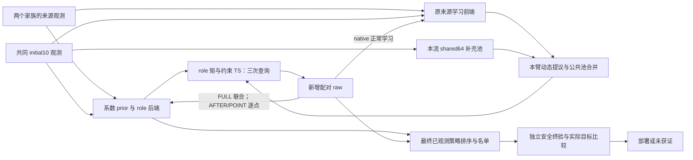

# Stage102：来源先验跨策略传播的方法正文工作稿

本稿描述当前冻结的AFTER主线及其对照，承接[研究论证](mainline_research_argument_20261019.md)；实验设计、结果和费用见[实验正文工作稿](mainline_experiments_working_draft_20261019.md)。方法对象是公开结构表示与动态候选前端支持下的实际d=1000仿真优化。

[Stage103统一方法与完整计划](mainline_unified_method_and_plan_20261019.md)补齐旧组合前端与当前后端的继承关系，以及四类meta-prior在实际冻结配置中的分工。当前系统已包含旧LearnedMetaPrior前端；历史前端贡献与固定前端下的初始化传播增量共同组成方法证据。SourceScoredProfileAtlas与raw-KG保留各自实现和证据身份，未因此替换当前生产链。

[Stage104证明审查](mainline_proof_gap_audit_and_plan_20261020.md)已连接实现位置、数学命题、当前Lean声明与正文主张。这里的联合更新每轮以局部非高斯后验的矩补全全场，再投影回组件矩；FULL也不是原模型精确多轮后验。决策实际抽取f／g各自的高斯矩投影。下面的条件命题按这些实现语义组织。

## 任务、响应与跨维度公共表示

目标策略x是满足任务控制边界的1000维整数向量。一次仿真返回配对的标量化目标Y_f和原始约束响应Y_g；目标是减小f(x)=E[Y_f|x]，同时满足Pr(Y_g≤τ|x)≥1−α。在本实验的高斯噪声任务中，真实机会约束等价于μ_g(x)−τ+z_(1−α)σ_g(x)≤0。

后端以h_f=f、h_g=μ_g−τ为两个响应均值通道，以η_f、η_g表示单次仿真噪声方差的对数。已中心化的g通道与原始μ_g分开记号；目标raw的g减τ一次，决策接口需要原始单位时再加回τ。

来源档案使用d=50策略。跨维度迁移保留目标的实际1000维物理策略，按公共规则计算表示，而不是把来源或有限库中的低维索引当作目标动作。目标均值所用公共十维坐标是既有65列公共特征图归一化后的前十列：先形成策略均值、标准差和八个加权余弦，再拼接全二次项，整组除以max(二范数,1)，最后截取前十列。因而其归一化分母也依赖二次项。公开的控制组、占用及曝光描述保留实际动作结构，只有曲线动态部分重采样到共同50点网格，以消除该部分随维数改变的尺度差异。

另一个十维坐标由来源响应监督学习：f、g均值各两轴，η_g、η_f各三轴；训练后的映射及来源标准化参数在目标阶段固定。公开表示给出结构输入，来源数据学习响应相关方向、基函数字典和系数分布，两者承担不同作用。[公共坐标](../representation/legacy_function_prior.py#L11)；[曝光表示与来源坐标](../representation/legacy_observable_prior.py#L15)。

## 来源档案、结构身份与系数先验

为每个目标家族保留一套排除该家族的来源资产。Inventory、Queue、FactorShock分别使用另外两个家族；每家族64个策略，每点有3次配对f/g重复，因此一套档案含128个策略—家族记录、384次已有来源调用。两个来源家族使用相同的64个物理策略，但响应、任务身份及阈值各自保留。

来源标签包括f均值、g均值减来源τ，以及两个噪声方差的对数标签。后者按重复方差作偏差修正：η标签为log(s²)−ψ((n−1)/2)+log((n−1)/2)，其中n=3、s²使用ddof=1。来源真值、真实chance margin不作为这些标签。[标签构造](../representation/legacy_function_prior.py#L20)。

原结构资产包含八种身份：谱基／加性基、按头支持／联合支持、观测任务协方差／去噪任务协方差的笛卡尔积。按头支持分别使用公共均值坐标与来源噪声坐标；联合支持使用两者拼接。基函数、来源共享系数分布、任务差异和白噪声项由来源记录确定；来源样本均值与重复方差进入原正态／卡方来源似然。来源端以每个身份、每个响应头固定1024节点的正权重规则表示噪声不确定性，并用保存的来源证据确定身份权重。

对某一身份k及来源求积节点q，均值头在有限策略集合上的条件形式为

\[
h_a(x)=\phi_{ka}(x)^\top\beta_{ka}+u_{ka}(x),\qquad
\operatorname{Cov}[h_a(x),h_a(x')\mid k,q]
=\phi_{ka}(x)^\top(\Sigma_{ka,q}+T_{ka})\phi_{ka}(x')
+v_{ka}\mathbf1\{x=x'\},\quad a\in\{f,g\}.
\]

这里Σ是来源条件化后共享系数协方差，T是登记的任务差异项，v是策略白噪声项；η头使用自身设计与系数分布。节点与身份混合还贡献组间均值差形成的协方差。该条件表达对应代码投影，不把拟合后的所有不确定性压成一个固定核。[来源拟合与条件化](../performance/mainline_legacy_source_models.py#L150)；[有限池投影](../performance/mainline_legacy_source_models.py#L269)。

当前role配方在上述结构资产中执行一个明确的边际替换：从冻结native来源模型取得g系数均值、协方差和校准后的偏差方差，在每个来源节点以同一native风险基替换g均值通道。其T_g置零，系数截距减当前任务τ；f、两个η通道及来源节点／身份权重保留。因而g的跨策略协方差含φ_g(x)ᵀΣ_gφ_g(x′)，但原来源g–η依赖被切断。这是来源边际拼接，不能称为对整套f/g/η联合模型重新拟合。[实际替换](../performance/mainline_role_prior.py#L20)。

## 初始化传播与逐点对照

目标更新使用已付配对raw。令Z_f=Y_f、Z_g=Y_g−τ，逐头采用Z_a|h_a,η_a∼N(h_a,exp(η_a))的原始观测条件化。每个头的均值与噪声潜变量、节点权重以及共享身份权重均可随观测更新；两个头通过身份混合相连。候选决策使用噪声混合期望E[exp(η_a)]，不是exp(E[η_a])。

所有臂共用来源设计seed80给出的十个初始物理策略。同一几何、同一观测流只支付一次initial10并向各臂复用相同raw；下一条独立流重新产生观测。三种role更新规则为：

| 后端 | initial10 | 之后三次查询的raw如何进入role后端 |
|---|---|---|
| FULL | 联合条件化，允许跨策略传播 | 继续对联合模型条件化 |
| AFTER | 与FULL相同，保存完整初始化条件节点 | 只条件化实际观测策略的局部模型 |
| POINT | 每个策略只使用自身已付观测 | 继续只条件化实际观测策略的局部模型 |

AFTER对新候选从同一initial10后验投影；POINT对未采样候选保留source0边际。逐点更新仍保留本策略局部模型内的均值—噪声联合状态和本地身份／节点权重。为了向决策器提供跨策略矩，POINT固定source0相关矩阵，AFTER固定initial10后的相关矩阵，再按当前局部边际标准差缩放：

\[
C_t=D_tC_bD_t,\qquad
(D_t)_{ii}=\sqrt{v_{t,i}/v_{b,i}},\qquad
b=0\ \text{(POINT)},\quad b=10\ \text{(AFTER)}.
\]

指标i遍历候选策略的[f,η_f,g,η_g]坐标。因此逐点不是协方差清零；涉及已更新点的协方差块仍随标准差变化。这一供决策使用的高斯矩对照，也不是切换后重新建立的完整联合贝叶斯后验。[POINT](../performance/mainline_role_point_only.py#L1)；[AFTER](../performance/mainline_role_after_init.py#L133)。

AFTER−POINT干预的是角色后端初始化联合条件化相对逐点条件化的总体作用。两臂原native提议后验、前端及其反馈学习均照常使用本臂新观测；AFTER只限制之后的role后端更新，并未冻结整个系统。

## 公共候选补充、动态前端与查询

每条流在STOP的initial10状态上，用原已观测近邻生成器产生请求规模64的公共补充池，半径0.08、安全裕量尺度1；其随机流与native提议／采集流分开。池内物理策略在同流各臂间共享，独立观测流各自生成自己的补充池。后续候选不是静态库：原native前端按冻结家族配置继续组合来源／形状、任务后验、近邻、复采等提议，并追加这份流内公共池。各臂历史分叉后，native动态提议可以不同。[公共池](../performance/mainline_shared_neighbors.py#L18)；[实际搜索复用](../performance/run_mainline_role_fresh.py#L23)；[候选通道](../algorithms/single_olhkg.py#L5403)。

每个在线臂在initial10后查询三次。当前查询规则是约束Thompson sampling（constrained TS）：将后端混合矩投影为每个响应头的联合高斯，在整个候选池上分别抽取f与原始μ_g函数值；用\(\tilde m(x)=\tilde\mu_g(x)-\tau+z_{1-\alpha}\sqrt{E[\exp(\eta_g(x))]}\)判定本次抽样可行性。实现将根号内噪声方差下限设为`_EPS`。若有\(\tilde m≤0\)的候选，则从中选抽样目标最小者；否则最小化\(\ell(x)=\tilde m(x)+\mathrm{eps}_{\rm mach}\tilde f(x)/\max(\max_{u}|\tilde f(u)|,1)\)。该目标项也可改变极小非零裕量差的顺序。已观测策略可以被复采。[矩接口](../performance/mainline_legacy_backend.py#L47)；[约束TS](../acquisition/decision_backends.py#L1595)。

同源GP与原结构后端均复用相同来源档案和公共十维／来源风险十维表示，并接入相同前端和决策规则；native原后端保留其历史表示与HVD。role的g使用上述native边际，故这组后端比较不构成三者表示完全相同的纯prior消融。[后端接线](../performance/mainline_role_backend.py#L76)；[历史接回边界](mainline_legacy_backend_bridge_results_20261015.md)。

## 已观测名单、独立终验与预算

查询结束后，终端仅对已观测策略排序。后验违约概率不超过0.5的点优先按目标均值排序；若无点满足该资格，按后验违约概率优先。名单构造沿冻结的目标挑战者／主荐／安全支持规则，并保留initial10中经验目标均值最小的参考点；该参考点不按真实可行性或目标真值选择。[排序](../acquisition/decision_backends.py#L55)；[名单构造](../algorithms/single_olhkg.py#L1215)；[初始参考点](../core/terminal_verification.py#L138)。

当前“旧终端”具体指same_policy_distinct_challenger：三点名单冻结后，若第一点恰好就是初始参考点，则把其余两点中原后验排名较高者移到第一槽，参考点放第二槽，其余点保留。其他名单不作此重排。[固定变换](../performance/run_mainline_same_policy.py#L30)。

三槽安全验证预算为80/128/128，每点使用δ=0.05/3的高斯非中心t分位数容忍上界判断机会约束。验证只使用独立新增重复，不复用搜索样本，也不反向更新搜索后验。名单资格阈值0.5只是后验排序规则，实际安全证书来自这一独立验证。

先验证挑战者和初始参考点。两者均获证时，在另一独立随机块进行8对共同随机数目标比较，比较δ同为0.05/3；只有挑战者减参考点的目标差单侧t上界小于0才替换参考点。仅一者获证时部署该点；两者都未获证时才验证第三点。第三点不是每次都被验证，也不参与额外目标比较；全无证时保留未获证状态。[验证与比较](../core/terminal_verification.py#L283)；[终端分支](../core/terminal_verification.py#L747)。

每格登记终验上限为352=80+128+128+2×8；现行成功执行分支中224次的双获证比较路径与336次的第三点回退路径互斥，不能把上限当实际花费。在线臂逻辑总上限为10+3+352=365，STOP为10+352=362；初始观测的流内共享另记物理费用。FULL／AFTER另保留同一搜索历史、改用native后端排序的终端对照；它们增加终端格，不增加搜索查询。

## 来源关联对照与评价接口

来源对照对每套档案的64个共同策略索引一次生成固定置换π；在两个来源家族中同时令位置i接收该家族原位置π(i)的完整3×2配对响应块。物理策略、家族身份、阈值及策略来源标签不变，重复、f/g及两个家族之间的响应配对保留，固定点不剔除。派生均值、重复方差和native噪声摘要按原公式同步重算；所有响应依赖映射和来源分布按原配方重新建立并封存。[整块置换](../performance/mainline_source_alignment_archive.py#L103)。

置换AFTER／POINT各同时替换结构bundle和native风险系数先验，用实际目标d、几何与τ构造独立后端上下文；原真实来源前端、初始化设计和动态提议规则保持原样。两置换臂共享同一套置换资产，不选择更有利的置换；原9个终端对照全部保留，加上两置换臂共11臂。该对照检验固定学习前端下正确策略—响应关联的价值。[独立上下文](../performance/mainline_source_alignment_backend.py#L20)；[冻结协议](mainline_source_alignment_control_protocol_20261018.md)。

全部搜索历史与终端输入先冻结，全部终验或失败封存后才访问评价真值。C表示获证且真实可行；Q(x)=clip(1−f(x)/dot(weights,ref_point),0,1)，G=C·[Q(x_deployed)−Q(b)]，其中b仅在评价时选为initial10内真实可行、真实目标最小的点。G保留负值。无初始可行基线时G未知，执行失败时C/G未知；完成但未真实获证且有基线时G按登记为0。[指标与配对口径](mainline_experiments_working_draft_20261019.md#指标真实获证带符号质量与损失)。

## 当前实现的证明接口

[当前主线Lean接口](../../proof/SCOLHKG/CurrentMainlineProofInterface.lean)的七个当前模块共94条定理，16模块依赖闭包已通过Lean 4.31.0。以下四项条件命题及失配解释分别对应[实现—数学—Lean映射](mainline_proof_gap_audit_and_plan_20261020.md#实现数学lean正文对应)；数学推导见[传播与目标差](mainline_propagation_contrast_proof_20261020.md)和[终端守门树](mainline_terminal_gate_proof_20261020.md)。

**命题1：有限工作协方差与逐点对照。** 给定PSD系数／任务协方差、非负白项和归一非负混合权重，来源投影、混合矩及role独立分块替换保持PSD，投影与子池限制一致。AFTER／POINT的\(D C_bD\)保持PSD；基线对角为正、局部方差非负时匹配局部对角，正方差坐标间保持基线相关性。

**命题2：未采样目标差的传播。** 在每个组件j中，令\(d_j=m_j(u)-m_j(v)\)、\(A_j=C_{j,:o}C_{j,oo}^{-1}\)，局部更新为\((\Delta m_{o,j},\Delta S_j)\)。当前矩补全给出均值变化\(A_j\Delta m_{o,j}\)和协方差变化\(A_j\Delta S_jA_j^\top\)。连同证据更新，混合目标差满足

\[
\bar d^+-\bar d
=\sum_jw_j^+(A_{j,u}-A_{j,v})\Delta m_{o,j}
 +\sum_j(w_j^+-w_j)d_j.
\]

第一项由两策略与观测位置的关系差异控制；第二项保留身份／节点重权。相同loading只消除第一项。已知噪声单高斯特例中，差值方差减量为\([K(u,x)-K(v,x)]^2/[K(x,x)+r]\)。

**命题3：表示扰动与当前一步查询。** 在明确的重建、求积、冻结encoder及正尺度误差条件下，公共坐标误差可传到预测均值和双线性核。固定同一有序候选池及实际抽样随机向量，\(F=m+L\xi\)的误差不超过\(\epsilon_\mu+\sum_j\epsilon_{L,j}|\xi_j|\)，机会margin再加\(|z_{1-\alpha}|\epsilon_\sigma\)。若margin到零的距离大于其误差，可行集相同；可行目标间隔或无可行点时完整\(\ell\)的间隔超过相应误差的两倍，则本步查询相同。

**命题4：实际终端的联合错误与费用。** 给定局部安全覆盖界、目标比较错误界及新随机块的门控条件界，第三点安全验证与两点目标比较互斥，因而

\[
\Pr(\text{返回获证且不安全}\ \cup\ \text{错误宣告目标改善})
\le\delta_1+\delta_2+\max(\delta_3,\delta_c)=0.05.
\]

这里四份局部预算均为\(0.05/3\)。返回和调用树同时覆盖已述208／224／336次成功路径及352登记上限。

**固定仿射规则的失配解释。** 条件于来源资产，在目标分布上对固定预测\(\hat U=m_U+a(Y-m_Y)\)，令\(S_Y=\operatorname{Cov}(Y)\)，参考系数满足正规方程\(a_*S_Y=\operatorname{Cov}(U,Y)\)。在所列矩可积条件下，真实MSE等于最优线性残差、非负项\((a-a_*)S_Y(a-a_*)^\top\)与均值偏差平方之和。来源关系失配因此可以抵消可用的信息收益；这是解释固定预测规则的命题。

## 适用范围与核对说明

上述Lean结论以合法来源资产矩、给定局部loading／矩变化、编码器与实际抽样loading的误差界为前提；Gaussian条件分布与非中心t枢轴推导在数学正文给出，未在当前Lean形式化。查询稳定性需共同候选池和随机向量，并要求两状态中的有限sentinel `-1e300`均严格低于相应最优可行分数；完整回退loss的误差含归一化目标项。首次查询分歧后的不同历史／动态池不由单步定理控制。当前形式化的重参数化不变性限于正对角变换；固定仿射失配分解不推出非线性混合AFTER的性能保证。终端5%是单格联合事件界，全无证返回、部署质量非负及三点最优性不在该结论内。

该方法依赖所声明的公共结构、来源任务和候选生成规则，不给出任意1000维黑箱保证。初始化对照不隔离纯协方差或单一查询中介；来源置换对照保留真实学习前端，也不等于无来源基线。固定来源求积与目标矩更新有保存的数值诊断及停止门槛，不能把有限运行成功写成全面精度认证；低ESS、原失败和相应未知结果均随实验报告保留。进一步前提见[证明审查的局限](mainline_proof_gap_audit_and_plan_20261020.md#6-局限哪些结论仍不能由这些证明推出)。

本次仅收束正文、映射和代码注释，复用[最近构建回执](../paper_artifacts/mainline_source_kernel_mismatch_lean_20261020_result.json)；无新增构建、服务器读取或科学调用，全部失败、恢复费用与余量原样保留。

本稿与[当前冻结manifest](../performance/manifests/mainline_source_alignment_targets_v1.json#L2543)逐项对齐：实际d1000、source0／initial10相关矩阵缩放、native g边际拼接、约束TS、三次查询、流内shared64、旧终端及365/362预算。Stage102仅新增正文，Stage103补充统一方法和证据入口；本方法及旧论文、模型、生产算法和科学记录未改变。Stage103仅对封存指标另作配对统计，见[补充结果](mainline_frozen_backend_comparison_results_20261019.md)。
