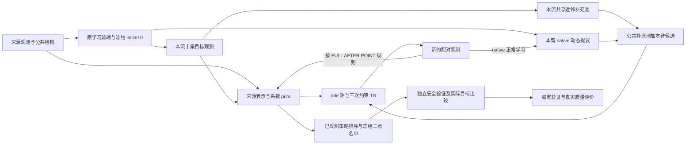

# Stage103：统一方法、已有证据与后续计划

2026-10-26的投稿交付从[当前主线复现包](../reproducibility/mainline_release/README.md)进入，状态与回执集中见[投稿交付验收](mainline_submission_release_20261026.md)。当前16模块Lean冷构建、94条声明及12项依赖核对已通过；G3真实小例已完成3搜索＋224独立终验，封存行为比对与最终归档以对应回执为准。Stage85/93封存结果、全部失败及恢复费用继续保留，余量不重置。

**统一主线是：来源数据在结构假设下帮助选择初始策略、学习策略之间的响应关系，再用少量目标观测改善查询与可验证部署。** 前端与后端可以放进同一方法和论证；不要求先证明四项prior各自增益或前后端协同交互，才允许整合。当前系统已经接回历史学习前端，整合首先是说明现有系统及证据，不是把三套算法重新串跑。

本文件承接[原始目标](original_goal_and_mainline_contract_20261015.md)、[Stage101论证](mainline_research_argument_20261019.md)、[方法正文](mainline_methods_working_draft_20261019.md)和[实验正文](mainline_experiments_working_draft_20261019.md)。[三版本讨论](../../markdown/GPT_3version_merge.md)作为建议来源；其新实验建议按本文的先后顺序和条件保留，不自动执行。

Stage104已完成[当前实现的证明审查与实现映射](mainline_proof_gap_audit_and_plan_20261020.md)：来源局部矩到未采样目标差的传播、AFTER／POINT语义、实际旧终端条件分支，以及跨维表示与查询间隔，均已接入当前接口。[方法正文](mainline_methods_working_draft_20261019.md#当前实现的证明接口)据此收为四项条件命题和固定仿射失配解释。旧Atlas／KG定理保留原适用对象，冻结算法不变。

当前三批主线Lean共94条定理、16模块依赖闭包已通过Lean 4.31.0：传播／协方差／终端32条，跨维表示／查询稳定性26条，最近一批来源核PSD／限制与固定仿射MSE36条。MSE直接使用概率测度上的期望，并保留可积性及正规方程；来源核以给定合法资产矩为条件。[最近构建回执](../paper_artifacts/mainline_source_kernel_mismatch_lean_20261020_result.json)计入1次缓存计划、3次人工构建（2次失败）和58.321 CPU秒，自动重派为零；[前轮](../paper_artifacts/mainline_stability_lean_20261020_result.json)及[首批](../paper_artifacts/mainline_lean_20261020_result.json)费用继续保留。此前已完成正文／映射及回退loss注释修正；本次将四项命题与已有封存配对结果接入[论文核心论证](mainline_research_argument_20261019.md#条件命题与封存证据如何共同支持主张)，并回填[实验联合解释](mainline_experiments_working_draft_20261019.md#条件命题与部署证据的联合解释)。两批主结果、来源C105/G97及净G交互未确认的范围不变；无新增统计重算、构建、服务器读取、科学计算或余量重置。

## 1. 版本身份与实际继承

| 实现／证据 | 实际对象 | 在统一方法中的位置 |
|---|---|---|
| 历史LearnedMetaPrior组合前端 | 通用低复杂度形状＋来源模板、来源安全／目标排序与覆盖式初始设计 | 当前冻结前端的直接来源；历史60/60组合前端研究属于这一实现 |
| 后来的SourceScoredProfileAtlas | 公共有限策略库、固定余弦坐标、来源排名、增广距离与farthest-first十点设计 | 独立的冷启动方法与跨网格证据；不是上述历史前端的别名，也不是当前AFTER已经替换进去的新模块 |
| V51完整在线链 | 来源函数先验、目标后验、HVD、新点／复采及在线KG | 保留旧在线成功与部件继承，不能概括为“旧工作只有初始化” |
| raw-KG数值线 | 声明起始信念下的混合后验、原始观测更新、终端价值与信息价值计算 | 保留数值分析和可能的局部参考；其严格HOLD不阻断当前可执行主线 |
| 当前AFTER／POINT／FULL | 原学习前端＋role来源先验＋初始化条件化对照＋三次约束TS＋旧终端 | 统一方法的现行实证主体；TS结果不改称KG优势 |

身份依据：[历史组合前端](../manuscript/meta_prior_legacy_frontend.tex#L3)、[Atlas独立实现](../core/profile_atlas.py#L1)、[V51历史合同](original_goal_and_mainline_contract_20261015.md#4-保留已有证据修正历史标签)、[当前构造入口](../performance/mainline_role_backend.py#L76)。旧论文和旧结果保留，不把旧万维、旧60/60或旧证明标签替换成当前算法的验证。

## 2. 四类meta-prior在前后端的真实分工

四类prior是共同的低复杂度结构语言；各版本、各模块可以使用其中不同部分。需要区别代码提供某开关、冻结资产实际启用该开关，以及已有对照支持其贡献这三件事。

当前三家族冻结设计均登记`initial_design_structural_prior_profile=low_frequency_only`、`proposal_mode=risk_objective_atlas`；原native运行配置则是`structural_prior_profile=none`，正交坐标和自适应稀疏开关为false，基模式为full_quadratic。这个运行配置不取消外接结构后端自己的选谱／加性设置，也不把已经生成的低频initial10改成无结构设计。

以下后端列描述保留的结构来源资产；**当前role的g均值已换成native风险边际，不能把原结构g谱／加性建模原封不动归给当前风险均值。** f、η和身份／节点权重保留，原g–η来源依赖被切断；具体拼接见下一节。

| prior | 当前冻结前端的实际作用／状态 | 结构来源后端的实际作用（role-g例外如上） | 可用的准确说法 |
|---|---|---|---|
| 正交 | 来源模板在公共策略坐标中排序和覆盖；冻结设计没有登记开启独立正交消融。类中虽有对应坐标变换，native当前开关为false | 谱基使用来源加权Gram的对称白化；加性基也去冗余并白化 | 减少基冗余、改善坐标条件；不等于统计独立或跨策略协方差为零，不保证目标分布仍正交 |
| 稀疏／低复杂度 | 通用形状限制提议复杂度；native自适应稀疏开关关闭，选十个点不等于学习了稀疏系数 | 谱基活动维上限6、加性组上限8，来源响应参与有限支持选择 | 当前有有限活动支持；不冒充各处都启用了同一种spike-and-slab后验 |
| 加性／低阶交互 | 分段、少控与平滑形状限定候选结构；冻结native坐标是full_quadratic，不是加性-only前端 | 加性身份启用strong heredity、最多2个交互，并与谱身份混合 | 限制响应组合复杂度并允许低阶交互；不强迫所有任务或所有身份完全可加 |
| 低频 | 冻结initial10明确为low_frequency_only：通用形状与来源模板提供可转移支持；动态提议继续保留既有来源／形状通道 | 来源邻接图低频能量、响应相关性和稳定性共同参与选谱；低频分量数8 | 前端描述策略曲线形状，后端衡量来源图上特征变化；二者对象不同，分别影响观测位置与函数关系 |

实际配置见三家族来源目录中的`native_resolved_task.json`：以[Inventory的运行开关](../paper_artifacts/mainline_legacy_backend_bridge_v1/source_models/InventorySupplyChain/native_resolved_task.json#L400)及[独立初始设计标记](../paper_artifacts/mainline_legacy_backend_bridge_v1/source_models/InventorySupplyChain/native_resolved_task.json#L10457)为定位；Queue和FactorShock同名记录保持相同开关。

后端依据为[冻结来源设置](../performance/mainline_legacy_source_models.py#L35)、[来源拟合入口](../performance/mainline_legacy_source_models.py#L186)、[谱基选择／白化](../representation/transferable_spectral.py#L125)、[来源图低频能量](../representation/transferable_spectral.py#L384)、[加性选择](../representation/additive_groups.py#L118)。前端候选与坐标见[通用形状](../representation/meta_prior.py#L5349)、[共用结构开关接口](../representation/meta_prior.py#L5692)、[风险／目标模板设计](../representation/meta_prior.py#L5860)。

V51的`structural_prior_profile=none`同样不意味着没有来源学习或低频候选；它说明统一四开关没有全开。Atlas的固定余弦／对角二次坐标、来源排名与覆盖也不能直接算作当前八身份来源系数后验。统一框架因此按模块分工表达，不以“四项在每个位置都全开”定义方法。

## 3. 已经接通的数据流与冻结算法

三套来源资产各排除对应目标家族，使用另两家族的2×64个策略—家族记录，每点3次paired f/g，共384条已有raw。公开十维均值坐标和来源学习的十维响应／噪声坐标支持d50→d1000；目标仍是实际1000维物理策略，13是搜索调用数。

结构资产学习谱／加性、按头／联合、观测／去噪任务协方差八身份。当前role把native的g来源系数边际接入该滤波，保留f、η及身份／节点权重；这是明确的边际替换，切断原g–η来源依赖，并非整套联合重新拟合。[role实现](../performance/mainline_role_prior.py#L1)。

同一来源档案同时用于前端布点和后端学习，属于同一份数据的不同用途，不是两份独立证据；在同一个后端似然内，每条raw只进入一次。native风险先验截距和观测raw-g各自在其中心化入口减一次tau，外层不重复平移；跨维表示与响应量纲沿[方法正文](mainline_methods_working_draft_20261019.md)。共享已付raw可以服务多个对照，实际调用和费用只记一次，臂的逻辑预算不重复计作实付。

AFTER在initial10联合传播后只更新观测点；POINT从source0起逐点更新；FULL持续联合传播。POINT／AFTER分别保留source0／initial10相关矩阵，再以本点更新后的标准差缩放；不是协方差清零。原native前端始终从本臂新增观测正常学习。

同一流从STOP观测生成shared64，流内各臂共享；流2不复制流1的银行。后续候选随各臂历史变化。每在线臂搜索10+3次；旧端为same_policy_distinct_challenger，安全80/128/128、独立8对目标比较、终验上限352；在线／STOP逻辑上限365/362，224与336实际分支互斥。详细流程见[方法正文](mainline_methods_working_draft_20261019.md)。

## 4. 已完成的证据放在什么位置

| 证据层 | 已完成事实 | 对统一论证的作用 |
|---|---|---|
| 历史组合前端 | proposal-only、Stacked GP、SAASBO均60/60；Sobol分别0/60、1/60、0/60；来源模板单独40/60、通用形状单独23/60 | 支持有用初始支持和前端互补，不能全部归给来源学习或某一后端 |
| V51旧在线链 | 原汇总19次改善、311新点／289复采；另一终端闭合记录26次改善 | 保留旧在线决策贡献，两套统计不拼接 |
| 当前来源留出 | 首次传播改善未采样目标／目标差MSE，同时风险均值MSE变差 | 证明传播有预测作用，也保留预测失配；d50来源诊断不充作d1000独立部署 |
| Stage85和Stage93 | 两批各144几何×两流，AFTER−POINT的C及有基线G分别为正 | 支持在同一有力前端上增加初始化后端传播的决策价值 |
| Stage93来源四臂 | 正确关联vs整块置换，来源主差C/G在105/97完整几何上为正；C交互为正，G交互未确认 | 区分来源总体价值与传播增量，完整144的来源效应仍未知 |
| Stage86／94保存路径 | 共同初始化状态查询改变可追到发现、名单、验证和部署，正质量与新增损失同时存在 | 连接机制和结果，路径分解不等于单一因果中介 |

各层出处、旧24批、全部正负例和费用沿[完整证据链](mainline_evidence_chain_20261018.md)保留。历史前端与当前后端证据可共同支撑模块化方法；现有结果没有单独估计“更换前端×传播”的协同增益，也没有要求该交互先成立才能写统一方法。

## 5. 本轮冻结的保存结果分析

本轮先完成本文，再只读封存记录开展补充分析；不新增仿真、终验、真值或候选评分、来源拟合、积分或后验恢复。比较口径在分析运行前固定，后续结果单独写入[冻结后端配对结果](mainline_frozen_backend_comparison_results_20261019.md)，不在本计划预填结论。

执行记录：本文口径先上传，再由t195236/node005通过13项替身并完成两批配对；新增科学调用0，原AFTER−POINT逐行与区间一致。结果已写入上述独立报告，本节比较对象、统计口径及后续条件保持原样。

- **两批分开：** Stage85和Stage93各144几何、每几何两流；更早24几何批只引用原报告，不合并分母。
- **主补充比较：** AFTER−same_source_gp，以及AFTER−legacy_native_neighbors；不据结果挑选比较对象。
- **一致性参照：** 原AFTER−POINT按相同读取路径复核是否还原封存统计，不改变它和来源四臂原来登记的主次身份。
- **保留范围：** Stage85全部9臂、Stage93全部11臂、原67个失败／missing、假获证、Queue来源警告及所有历史费用完整保留。

| 指标 | 沿用定义 | 缺失与解释 |
|---|---|---|
| C | 获证且真实可行 | 完成但未真实获证为0；执行失败为null |
| R | 已有获证质量C·Q(x_deployed) | 不依赖初始可行基线；只读已有Q，不补评分；失败仍null |
| G | C·[Q(x_deployed)−Q(b)] | b为评价时的初始真实可行最优点；无b则null；G不截正 |
| P／L | max(G,0)／max(−G,0)，G=P−L | 在每个臂、每条流先定义，再形成配对差；避免损失项为−ΔL |

Q沿用clip(1−f/dot(weights,ref_point),0,1)。定义见[已有metrics](../performance/summarize_mainline_two_comparison_development.py#L20)；R不是另造一个有利端点，不替换原C/G主结果。

每个指标先在同几何、同流形成臂间差，再平均两条必需流；任何必需单元缺失，则该几何该指标为null，不用剩余单流代替。C/R与G/P/L各自使用完整双流支持集；涉及G=P−L的分解时使用同一支持集，不能相减不同分母的臂均值。[原双流规则](../performance/summarize_mainline_confirmation_seed_replication.py#L150)。

跨几何均值和95%描述性t区间沿原[estimate](../performance/summarize_mainline_two_comparison_development.py#L48)。全登记集合有缺失时，全体均值／区间保持null，另报完整子集n及条件统计；不多重校正，也不把逐项区间包装成一组同时成立的确认结论。

每个比较保留分家族、单流、全部正／平／负／unknown、最大正贡献占比及去最大几何后的描述均值。去最大是集中度说明，不替换全样本结果；R与C并列用于覆盖缺基线几何，G/P/L用于区分新增质量与避免损失。不会因为某臂比较更好，就删除POINT、STOP、FULL或置换对照。

执行顺序为：核封存输入与臂映射→针对缺流、null、P/L和费用包含关系的替身检查→scheduler读取小结果并形成逐几何配对→汇总与解释。所有有意义统计通过node001–node006、vram=0、每worker单线程；原始大记录留服务器，仅拉小JSON或必要小表。缺字段停在未知，不恢复模型填表。

来源、搜索、终验、失败、评分和本轮分析费用分列；读取历史费用不变成新增费用。worker／attempt／wrapper的嵌套CPU不相加，未计量项保留unknown。已完成科学任务和失败均不重跑，基础设施问题只沿已有任务身份处理，不自动重新提交科学批次。

## 6. 本轮之后如何决定下一步

若保存结果支持AFTER相对GP或native的C/R/G增量，直接把对应范围写入统一方法结果，说明这是事后补充配对分析。若区间跨零或存在损失，同样写入；AFTER−POINT已有传播效应不因此消失，但相对该强对照的优势不成立或仍不确定。

若结果已足以说明“前端给支持、后端传播增加收益”，下一步是压缩论文方法、摘要、引言和讨论，并整理可复核的小结果及端到端入口。无需为了融合再新增一个算法版本。

如果仍有一个会改变核心结论的具体归因缺口，再从以下方案中选择最小的一项，另行登记与授权；不并行铺开全部实验。

### 有条件的初始化×传播2×2

| 初始设计 | AFTER | POINT |
|---|---|---|
| 当前来源引导initial10 | 保留当前方法规则 | 保留当前传播对照 |
| 合理、不按来源响应评分的结构化initial10 | 新独立对照 | 新独立对照 |

此设计回答来源布点与初始化传播是否互补。四臂保持相同来源后端、搜索和终验；同一初始设计下AFTER／POINT复用同raw，不同设计实际观测各自策略。对照设计不得按已打开目标真值选择；几何、预算、随机流、成本和交互支持集需先固定，旧已开结果不充作新确认。

不同initial10也会改变G的初始可行基线，跨前端比较主用共同定义的C／R；G用于同一初始化内部的AFTER−POINT，或在新协议中另行固定共同评价基准后比较。不能把相对不同基线的G差直接解释为前端带来的绝对质量增益。

只有当下一篇核心主张需要区分这两种作用，而现有记录无法回答时才启动；不要求交互必为正。若按固定预算得到无增量、负效应或不确定，就保留结果并停止该增强方向，不追加初始方案筛选或样本量。

### 其他建议的保留位置

- **匹配native-g的通用后端对照：** 若要隔离结构表示／先验本身的额外作用，固定前端、来源信息、native-g、TS和终验，再比较合理通用来源模型；与初始化2×2回答的问题不同，先选真正尚缺的一项。
- **来源学习表示vs固定表示：** 只在论文明确主张离线学得表示的独立价值时另立对照；AFTER−POINT共享表示，不能代替该问题，也不因此失去已证传播意义。
- **跨维度与失配：** d1000→d10000与固定d下增加有效方向／交互／高频分别登记；旧万维结果给经验起点，不直接转为当前AFTER万维结论。
- **raw-KG参考：** 只有发现影响实际决策的具体近似缺口，才考虑已匹配role先验和终端的有限参考；不把旧模型参考当新模型真值，不自动换回KG或重开所有query精算。
- **理论与复现：** [当前主张—实现—证明映射](mainline_proof_gap_audit_and_plan_20261020.md#实现数学lean正文对应)已完成，Atlas覆盖、raw-KG误差和高斯独立验证各保留原适用对象；下一步连接已保存统计与论文论证，不把全局regret或新外部任务设为融合许可条件。

## 7. 停止条件与交付边界

Stage100有限来源探针已按协议关闭：12项6144调用未复现异常，只支持固定来源输入可执行，不解释旧67失败。本计划不扩点、不放宽门槛、不恢复旧失败状态，也不要求填满全144来源归因后才写论文。[封存结论](mainline_source_finite_probe_results_20261019.md#局限与下一步)。

本轮保存结果分析一旦输出既定比较、完整缺失与费用即收束；统计不确定不是自动加实验的理由。发现真实读取／映射错误则修正分析接线并保留失败回执，不能借此修改冻结模型、候选、名单、终端、阈值或随机规则。

四prior可以共同组织方法，前后端可以共同组织证据；尚无逐项消融或协同试验只限制相应归因句，不阻断整合。对外结论始终区分历史前端、旧在线链、当前冻结算法和未来提议，正反例、未知量与实际费用随结果保留。
